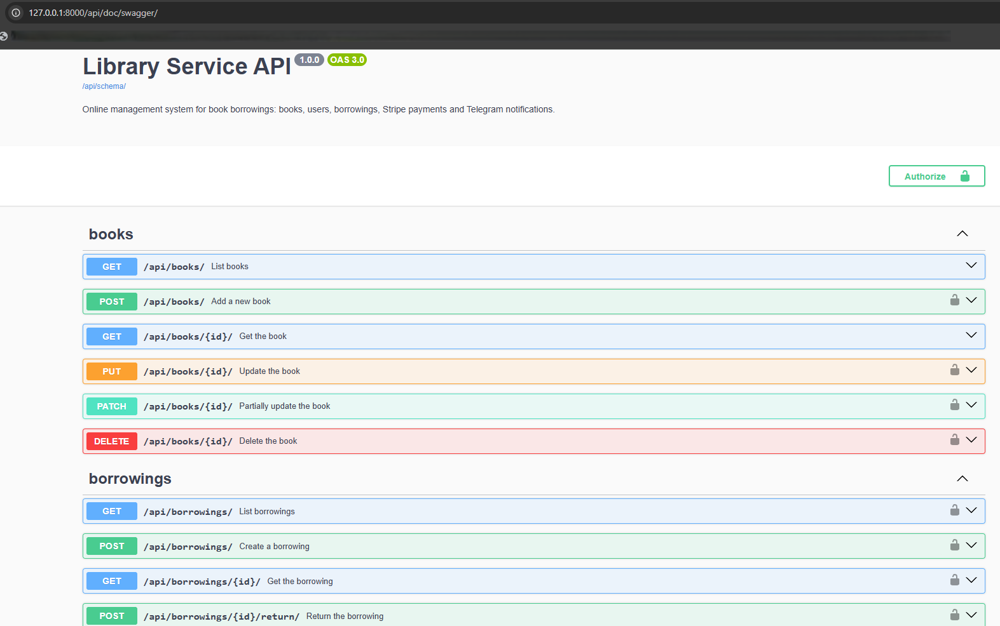
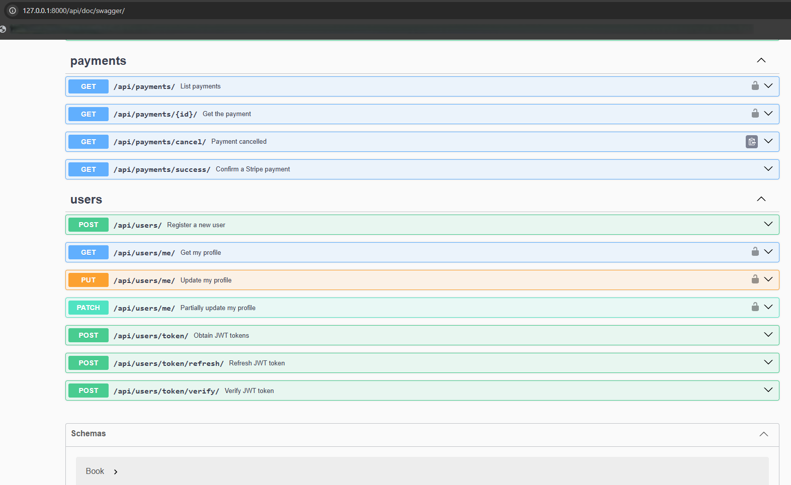
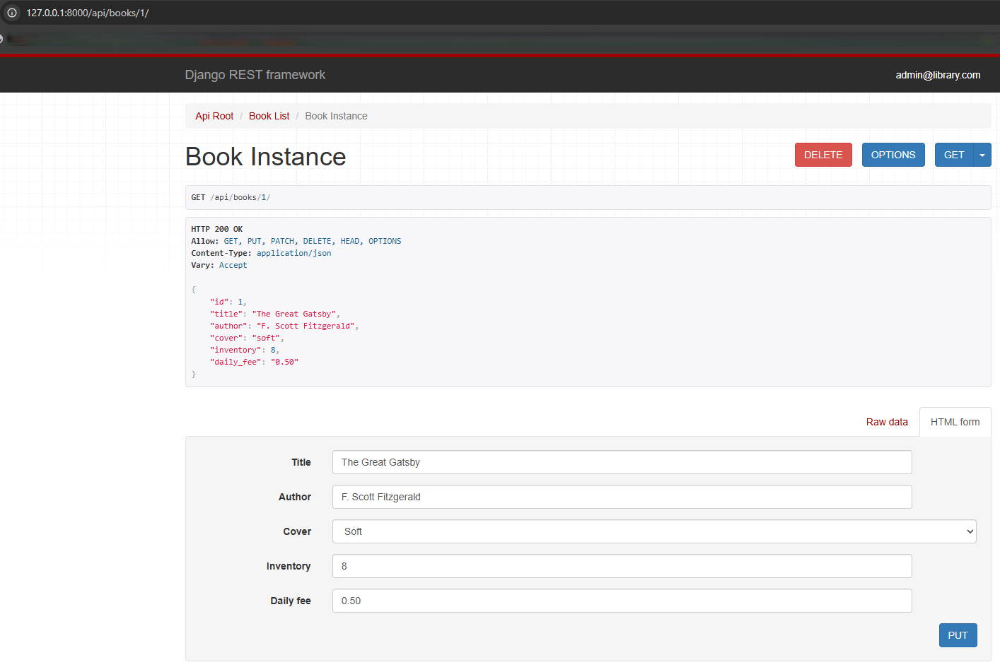
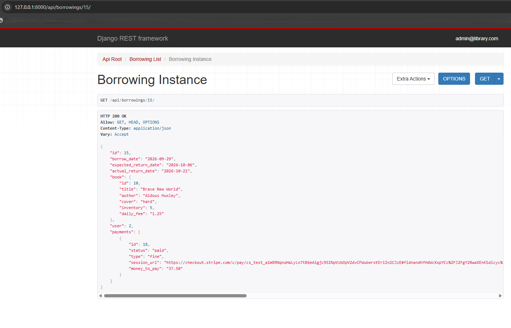
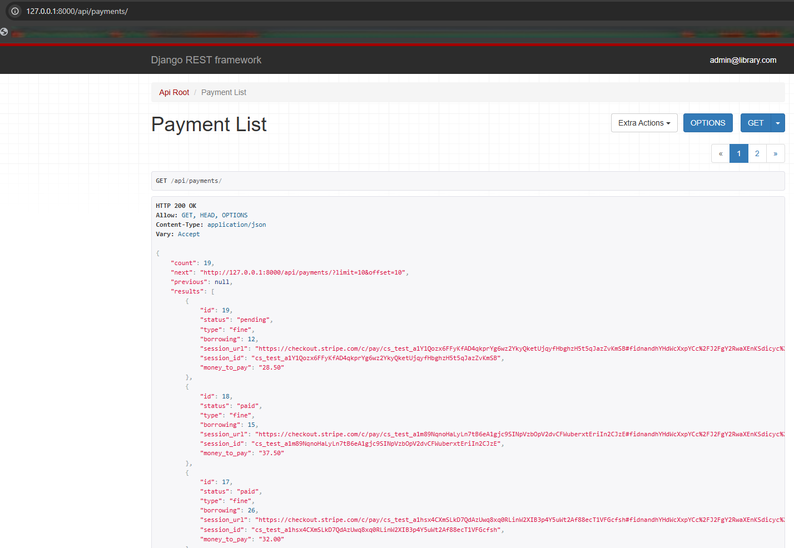
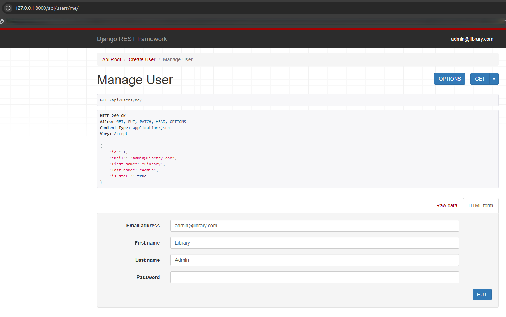
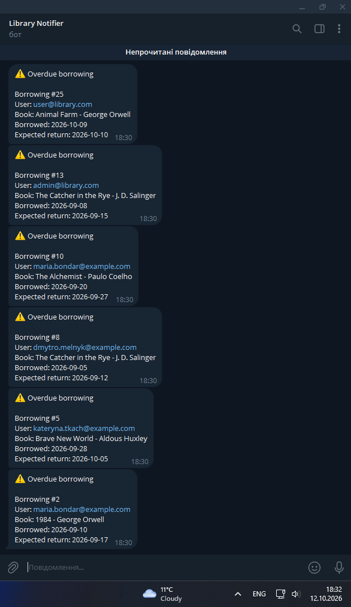
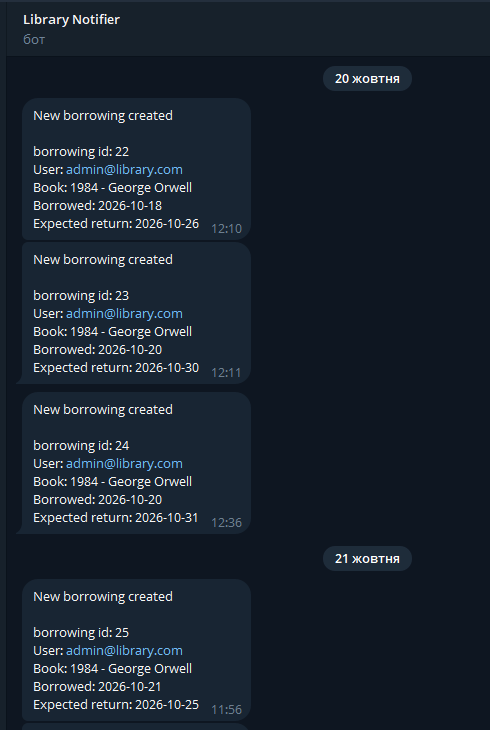
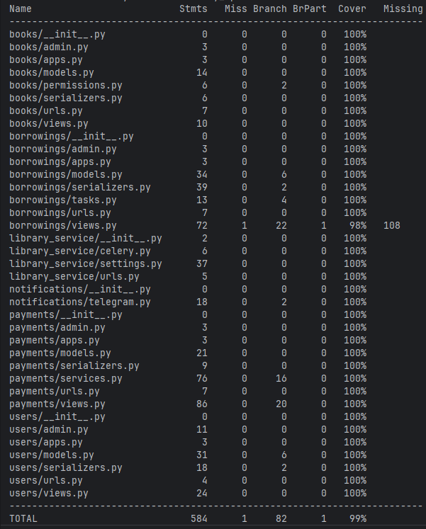

# Library Service API

[](https://github.com/AndriiHomeniuk1/drf-library-service/actions/workflows/ci.yml)

REST API for a library: books, borrowings, online payments and notifications.
It replaces manual paper tracking with a system where users borrow and return
books, pay for the rental (and for fines) online, and administrators get
notified in Telegram.

## Features

- **JWT authentication** with a custom user model (login by email).
- **Books**: public catalog, managed by administrators only.
- **Borrowings**: create and return a book; the book inventory is updated
  automatically. Users see only their own borrowings, administrators see
  everyone's. Filtering by `is_active` and `user_id`.
- **Payments with Stripe Checkout** (test mode): rental payment on borrowing
  creation and a **fine** when a book is returned late. Payments are confirmed
  by a **Stripe webhook** even if the user never returns to the site, and
  expired payments can be **renewed**.
- **Telegram notifications**: new borrowing, successful payment and a daily
  report of overdue borrowings (Celery Beat).
- **Pending-payment guard**: a user with an unpaid payment cannot borrow new
  books.
- **Interactive API docs**: Swagger UI and ReDoc (drf-spectacular), plus the
  Django admin panel.
- **Docker Compose** setup: API, PostgreSQL, Redis, Celery worker and Celery
  Beat.
- **Tests** (unit and API) with branch coverage, and a **CI** pipeline on
  GitHub Actions (flake8, black, tests).

## Tech stack

| Category            | Technology                                   |
|---------------------|----------------------------------------------|
| Language            | Python 3.14                                  |
| Framework           | Django 6, Django REST Framework              |
| Authentication      | JWT (Simple JWT)                             |
| Database            | PostgreSQL                                   |
| Task queue          | Celery, Celery Beat, Redis                   |
| Payments            | Stripe Checkout (test mode)                  |
| Notifications       | Telegram Bot API                             |
| API documentation   | drf-spectacular (Swagger UI, ReDoc)          |
| Web server / static | Gunicorn, WhiteNoise                         |
| Containerization    | Docker, Docker Compose                       |
| Code quality / CI   | flake8, black, coverage, GitHub Actions      |
| Development         | Django Debug Toolbar                         |


---

## Quick start (Docker)

Requirements: [Docker](https://docs.docker.com/get-docker/) with Docker
Compose.

1. Clone the repository:

   ```bash
   git clone https://github.com/AndriiHomeniuk1/drf-library-service.git
   cd drf-library-service
   ```

2. Create the `.env` file from the sample and fill it in
   (see [Environment variables](#environment-variables)):

   ```bash
   cp .env.sample .env
   ```

   On Windows PowerShell use `Copy-Item .env.sample .env`.

3. Build and start all services:

   ```bash
   docker compose up --build
   ```

   On start the API container applies migrations and collects static files.

4. (Optional) Load demo data: books, users, borrowings and payments:

   ```bash
   docker compose exec library_api python manage.py loaddata library_service_db_data.json
   ```

5. Open the API:

   | What            | URL                                      |
   |-----------------|------------------------------------------|
   | Swagger UI      | http://localhost:8000/api/doc/swagger/   |
   | ReDoc           | http://localhost:8000/api/doc/redoc/     |
   | OpenAPI schema  | http://localhost:8000/api/schema/        |
   | Admin panel     | http://localhost:8000/admin/             |

> Telegram and Stripe keys are optional for a first look: without them the
> API still works, but notifications are skipped and a Stripe Checkout session
> cannot be created (so creating a borrowing needs a Stripe test key).

### Demo accounts

After loading the demo data (step 4) you can log in with:

| Role          | Email               | Password     |
|---------------|---------------------|--------------|
| Administrator | `admin@library.com` | `admin12345` |
| User          | `user@library.com`  | `user123`    |

These accounts exist only for demonstration. Never use such credentials in a
real deployment.

## Environment variables

Copy `.env.sample` to `.env`. The `.env` file is ignored by git, so real
secrets never end up in the repository.

<details>
<summary>Show all variables</summary>

| Variable               | Description                                              |
|------------------------|----------------------------------------------------------|
| `DJANGO_SECRET_KEY`    | Django secret key. Avoid the `$` character in it.        |
| `DJANGO_DEBUG`         | `True` for development, `False` otherwise.               |
| `DJANGO_ALLOWED_HOSTS` | Comma-separated hosts, e.g. `localhost,127.0.0.1`.       |
| `POSTGRES_USER`        | Database user.                                           |
| `POSTGRES_PASSWORD`    | Database password.                                       |
| `POSTGRES_DB`          | Database name.                                           |
| `POSTGRES_HOST`        | Database host (`db` inside Docker Compose).              |
| `POSTGRES_PORT`        | Database port (`5432`).                                  |
| `CELERY_BROKER_URL`    | Redis URL (`redis://redis:6379/0` inside Docker).        |
| `STRIPE_SECRET_KEY`    | Stripe **test** secret key (`sk_test_...`).              |
| `STRIPE_WEBHOOK_SECRET`| Optional. Signing secret of the Stripe webhook (`whsec_...`). Without it the webhook is disabled.|
| `TELEGRAM_BOT_TOKEN`   | Token of your bot from [@BotFather](https://t.me/BotFather). |
| `TELEGRAM_CHAT_ID`     | ID of the chat that receives notifications.              |

</details>

Use Stripe in **test mode only**: no real money is ever charged.

## Authentication

The API uses JWT. The access token lives for 15 minutes, the refresh token
for 7 days.

1. Register: `POST /api/users/` with `email` and `password`
   (or use a [demo account](#demo-accounts)).
2. Get tokens: `POST /api/users/token/` with `email` and `password`.
3. Send the access token in the **`Authorize`** header (not the usual
   `Authorization`):

   ```
   Authorize: Bearer <access_token>
   ```

   In Swagger UI click **Authorize** and paste the access token.
4. Refresh with `POST /api/users/token/refresh/`.

## API overview

All endpoints are prefixed with `/api/`. List endpoints are paginated with
`?limit=` and `?offset=` (default page size: 10).

<details>
<summary>Show all endpoints</summary>

| Endpoint                          | Method(s)                  | Access            | Description                                    |
|-----------------------------------|----------------------------|-------------------|------------------------------------------------|
| `users/`                          | POST                       | Anyone            | Register                                       |
| `users/token/`, `.../refresh/`, `.../verify/` | POST           | Anyone            | Obtain, refresh and verify JWT                 |
| `users/me/`                       | GET, PUT, PATCH            | Authenticated     | View and update your profile                   |
| `books/`, `books/{id}/`           | GET                        | Anyone            | Book catalog                                   |
| `books/`, `books/{id}/`           | POST, PUT, PATCH, DELETE   | Admin             | Manage books                                   |
| `borrowings/`                     | GET                        | Authenticated     | Own borrowings (admin: all). Filters below     |
| `borrowings/`                     | POST                       | Authenticated     | Borrow a book and get a payment link           |
| `borrowings/{id}/`                | GET                        | Authenticated     | Borrowing details with book and payments       |
| `borrowings/{id}/return/`         | POST                       | Authenticated     | Return a book (creates a fine if late)         |
| `payments/`, `payments/{id}/`     | GET                        | Authenticated     | Own payments (admin: all)                      |
| `payments/success/`               | GET                        | Anyone (Stripe redirect) | Confirms a paid Stripe session          |
| `payments/cancel/`                | GET                        | Anyone (Stripe redirect) | Payment was cancelled                   |
| `payments/{id}/renew/`            | POST                       | Authenticated       | Renew a payment whose Stripe session expired |
| `payments/webhook/`               | POST                       | Stripe (signed) | Receives Stripe events, confirms payments and expires sessions |

</details>

Borrowing list filters:

- `?is_active=true|false`: borrowings that are not / already returned.
- `?user_id=<id>`: **administrators only**, limits the list to one user.

The full, always up-to-date description with request and response examples is
available in Swagger UI.

## How it works

### Borrowing a book

1. `POST /api/borrowings/` with `borrow_date`, `expected_return_date` and
   `book` (the user is taken from the token).
2. The book must be in stock; its inventory is decreased by 1.
3. A Stripe Checkout session is created. The response contains the payment
   with a `session_url`; open it to pay.
4. A notification is sent to Telegram.

A user who has at least one **pending or expired** (unpaid) payment cannot
borrow new books.

### Payments

- **Rental price** = `daily_fee` x number of days between `borrow_date` and
  `expected_return_date` (at least 1 day).
- A payment is marked as `paid` in two ways: by the
  [Stripe webhook](#stripe-webhook), or when Stripe redirects the user to
  `payments/success/`, which checks the session with Stripe. Whichever comes
  first confirms it and sends the Telegram notification, once.
- `payments/cancel/` tells the user the payment can be made later.
- Test card for Stripe test mode: `4242 4242 4242 4242`, any future expiry
  date and any CVC.
- A payment expires together with its Stripe session (24 hours). Expired
  payments are unpaid, so they still block new borrowings, but they can be
  renewed with `POST payments/{id}/renew/`, which creates a new Checkout
  session.

### Returning a book

`POST /api/borrowings/{id}/return/` sets the actual return date and increases
the inventory by 1. A borrowing cannot be returned twice.

If the book is returned after `expected_return_date`, a **fine** payment is
created:

```
fine = overdue_days x daily_fee x FINE_MULTIPLIER   (FINE_MULTIPLIER = 2)
```

### Notifications

A Telegram message is sent when a borrowing is created and when a payment is
completed. In addition, Celery Beat runs `check_overdue_borrowings` every day
at 09:00 (Europe/Kyiv time) and reports every borrowing that is due today or
overdue, or "No borrowings overdue today!" when there are none.

### Stripe webhook

Stripe notifies the API when a payment is completed or its session expires,
so a payment is confirmed even if the user closes the browser before the
success page. To try it locally, install the [Stripe CLI](https://docs.stripe.com/stripe-cli)
and run:

```bash
stripe listen --forward-to localhost:8000/api/payments/webhook/
```

Put the printed `whsec_...` secret in `STRIPE_WEBHOOK_SECRET` in `.env` and
restart `library_api`. In a real deployment register the endpoint in the
Stripe Dashboard and subscribe to `checkout.session.completed`,
`checkout.session.async_payment_succeeded` and `checkout.session.expired`.

## Services in Docker Compose

| Service       | Purpose                                              |
|---------------|------------------------------------------------------|
| `library_api` | Django app served by Gunicorn on port 8000           |
| `db`          | PostgreSQL                                           |
| `redis`       | Celery broker                                        |
| `celery`      | Celery worker                                        |
| `celery-beat` | Celery scheduler (daily overdue check)               |

Useful commands:

```bash
docker compose up -d                 # start in the background
docker compose logs -f library_api   # follow the API logs
docker compose down                  # stop (add -v to also remove the database volume)
docker compose exec library_api python manage.py createsuperuser
```

## Tests and code quality

Run the tests with coverage (Stripe and Telegram are mocked, so no network
access or real keys are needed):

```bash
docker compose run --rm library_api sh -c "coverage erase && coverage run manage.py test && coverage report"
```

Linting and formatting use flake8 and black (settings are in `.flake8` and
`pyproject.toml`):

```bash
pip install -r requirements-dev.txt
black .
flake8
```

The same checks (flake8, `black --check`, tests with a coverage threshold)
run on GitHub Actions for every pull request and push to `develop` and
`main`.

## Debugging

With `DJANGO_DEBUG=True` in `.env`, [Django Debug Toolbar](https://django-debug-toolbar.readthedocs.io/)
is shown on HTML pages, for example on the browsable API at
http://localhost:8000/api/books/. Restart the `library_api` container after
changing `.env`.

## Notes and limitations

- Payments work with Stripe **test mode** only.
- There is no refund when a book is returned earlier than expected.
- `payments/success/`, `payments/cancel/` and `payments/webhook/` are open
  endpoints, because Stripe calls them (the first two redirect the user's
  browser, the webhook is a server-to-server request). The webhook accepts
  only requests with a valid Stripe signature.
- Without `STRIPE_WEBHOOK_SECRET` the webhook is disabled (it answers 503)
  and payments are confirmed only when the user returns to
  `payments/success/`.

---

## Screenshots

### API documentation (Swagger UI)





### Main endpoints
A few examples of API responses; the full list of endpoints is in Swagger UI.

Book details:



Borrowing details with the book and its payments:



Payments list:



User profile (`users/me/`):



### Telegram notifications





### Test coverage



---

## Author

[Built by Andrii Homeniuk](https://github.com/AndriiHomeniuk1)
